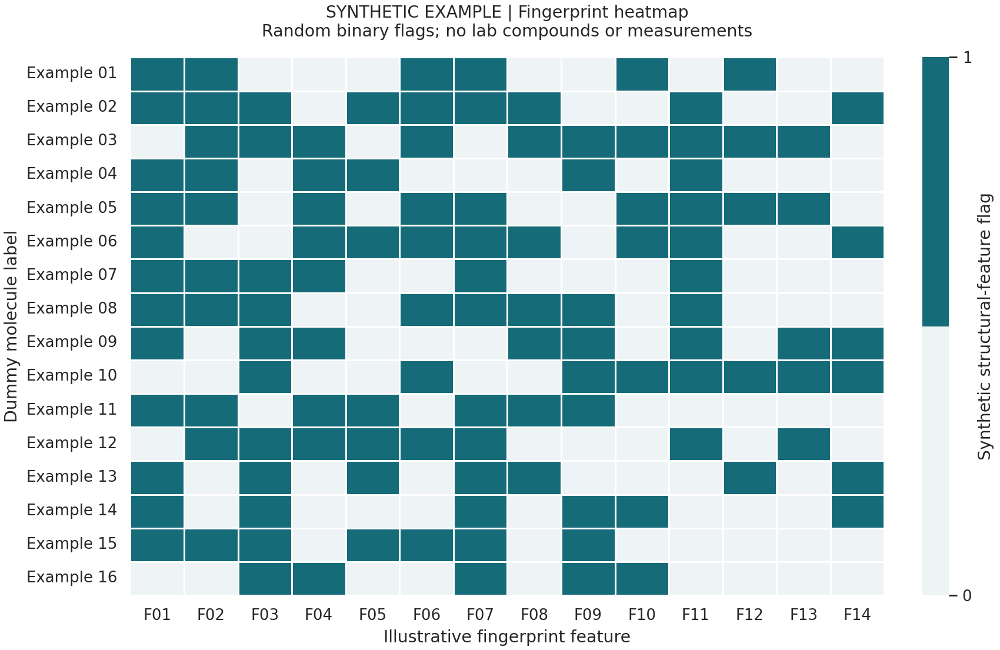
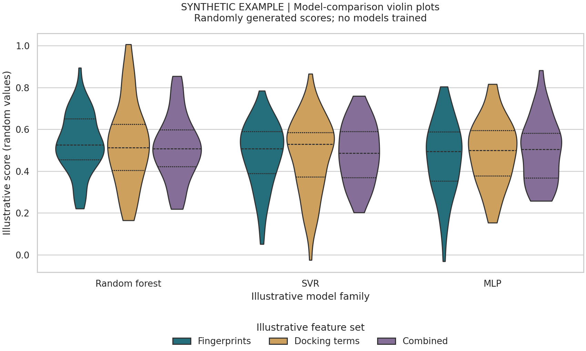

BACE1 activity prediction
An exploratory notebook using molecular fingerprints and docking-derived energy/interaction features to predict BACE1-associated activity. It exports existing SMILES strings to .smi files for PaDEL, aligns the resulting descriptors with activity records by molecule identifier, prepares activity targets, selects features, and compares regression methods, including random forests, support-vector models and a LazyPredict benchmark with a neural network. Heatmaps, violin plots, prediction plots and SHAP analyses support interpretation.

Process:
Effectively, the descriptors abstract the molecules into a viable data input for the model: that being a vector in a larger matrix with columns describing different descriptors (like functional groups) such as alcohol/hydroxide group or more general classifications such as carbon chain length.
Then because there a numerous descriptors and since PaDEL does not discriminate between any features there must effectively be a noise filter sop that the input parameters do not number into the thousands and clearly (with more general information such as carbon chain length there is a high likelihood of those descriptors being mis-associated with some prediction power). The filtering algorithm appears through, firstly, a deletion of low-variance features common descriptors across many or all elements of the training data; then, a selection of the top 12 descriptors those most associated after 50 tests on different 80/20 data splits. Thus, after filtering for those top features we get our parameters for the model, which can be split into two: the first being simulated docking energy (this not being included in the code as my mentor provided that data) and the top 12 descriptors. Using those parameters, we evaluated many different machine learning models (NuSVR, ExtraTreesRegressor, GradientBoostingRegressor) using their mean R-Squared values across many tests.

Dependencies: 
Python/Jupyter; NumPy, pandas, SciPy, scikit-learn, matplotlib, seaborn and NetworkX. Optional branches use LazyPredict, XGBoost, LightGBM, SHAP and mlxtend. Fingerprint generation requires Java and PaDEL-Descriptor. See requirements.txt and requirements-optional.txt; historical APIs may require compatible versions.

Data: 
Lab datasets and saved research outputs are withheld. Private feature selections are redacted. Reproduction requires authorized inputs; the notebook contains alternative exploratory branches.

The fingerprint workflow draws on the Data Professor tutorial. Previews below are only dummy so as to contain any proprietary information that belongs to me old lab. However, appearance-wise, it is still a demonstration of what was on my publications and demonstrates what the outputs appear as.

Presented Results: 

Visualization examples
Synthetic illustrations of the plotting styles, generated from random values. These are not research results.

