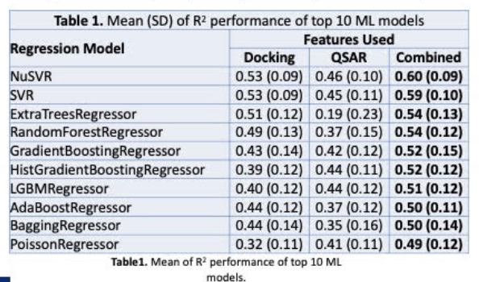

BACE1 activity prediction
An exploratory research notebook comparing molecular fingerprints, docking-derived energy/interaction features, and their combination for predicting BACE1-associated activity. The analysis includes data alignment, feature selection, regression comparisons, and interpretation through heatmaps, violin plots, prediction plots, and SHAP analyses.

Process: Effectively, the descriptors abstract the molecules into a viable data input for the model: that being a vector in a larger matrix with columns describing different descriptors (like functional groups) such as alcohol/hydroxide group or more general classifications such as carbon chain length. Then because there a numerous descriptors and since PaDEL does not discriminate between any features there must effectively be a noise filter sop that the input parameters do not number into the thousands and clearly (with more general information such as carbon chain length there is a high likelihood of those descriptors being mis-associated with some prediction power). The filtering algorithm appears through, firstly, a deletion of low-variance features common descriptors across many or all elements of the training data; then, a selection of the top 12 descriptors those most associated after 50 tests on different 80/20 data splits. Thus, after filtering for those top features we get our parameters for the model, which can be split into two: the first being simulated docking energy (this not being included in the code as my mentor provided that data) and the top 12 descriptors. Using those parameters, we evaluated many different machine learning models (NuSVR, ExtraTreesRegressor, GradientBoostingRegressor) using their mean R-Squared values across many tests.

The notebook explores low-variance filtering, standardized Ridge-based feature ranking, and selection frequency across repeated 80/20 splits to reduce the input feature set. It then compares docking-only, selected-fingerprint-only, and combined inputs using regressors including NuSVR, random forests, ExtraTrees, and gradient boosting. Performance is summarized using mean R² and standard deviation across repeated evaluations. Docking features were supplied by my mentor; their simulation is not implemented here.

Results from my research poster
Regression model comparison presented in my research poster

The table reports mean R² (standard deviation) from the original poster experiments. NuSVR with combined features achieved the highest reported mean R² of 0.60 (SD 0.09). These are previously presented results; the private analysis was not rerun when preparing this public copy.

Dependencies
Python/Jupyter; NumPy, pandas, SciPy, scikit-learn, matplotlib, seaborn, and NetworkX. Optional branches use LazyPredict, XGBoost, LightGBM, SHAP, and mlxtend. Fingerprint generation requires Java and PaDEL-Descriptor. See requirements.txt and requirements-optional.txt; historical APIs may require compatible versions.

Data and attribution
The lab datasets and original saved notebook outputs are withheld; private feature selections are redacted. Reproduction requires authorized inputs. The notebook retains alternative exploratory branches.

The fingerprint workflow draws on the Data Professor tutorial. Previews below are only dummy so as to contain any proprietary information that belongs to my old lab. However, appearance-wise, it is still a demonstration of what was on my publications and demonstrates what the outputs appear as.

Poster Results: 

Synthetic visualization previews
These illustrate the plotting styles using randomly generated values. They are not research results.

Synthetic fingerprint heatmap

Synthetic model-comparison violin plots

